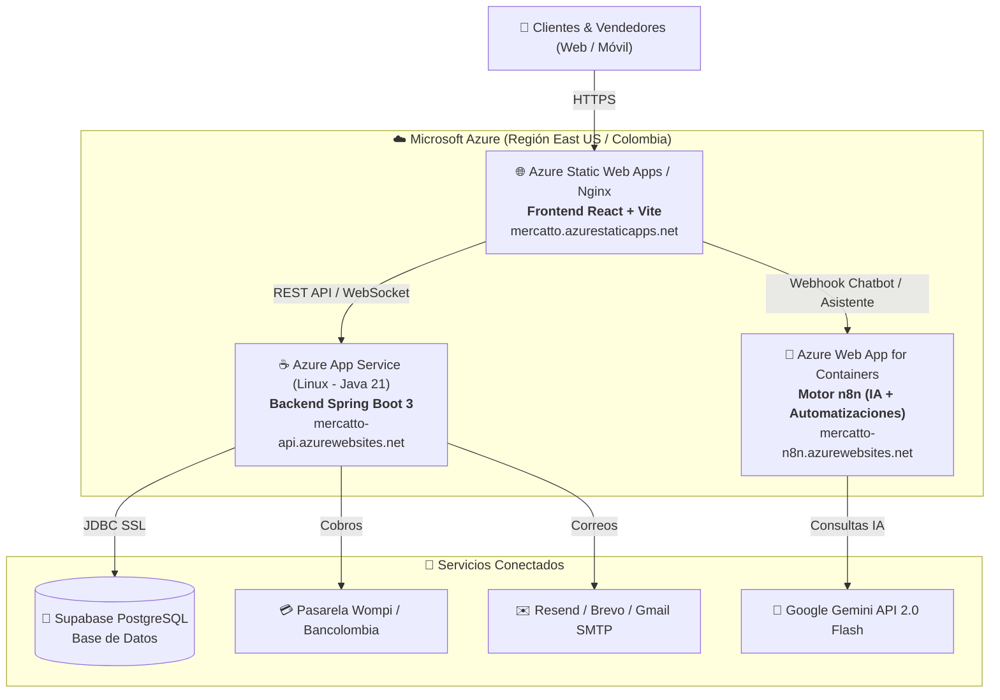

# 🚀 Guía Definitiva de Migración: De Render a Microsoft Azure
## Mercatto E-Commerce Marketplace + Motor de Automatización e IA (n8n)

Esta guía detalla el paso a paso exacto para migrar el sistema completo de **Mercatto** desde Render hacia la nube empresarial de **Microsoft Azure**, garantizando cero tiempos de caída, eliminación total del problema de suspensión/latencia (cold starts de Render) y operatividad completa de las automatizaciones de **n8n**.

---

## 🏗️ 1. Arquitectura de Mercatto en Microsoft Azure



---

## 🌟 2. Ventajas Clave de Migrar de Render a Azure

| Característica | 🛑 Render (Plan Gratuito / Básico) | ⚡ Microsoft Azure |
| :--- | :--- | :--- |
| **Suspensión por Inactividad** | Se duerme a los 15 minutos (causa demoras de hasta 60s al abrir la app). | **Always-On:** Nunca se duerme, responde al instante 24/7. |
| **Puertos de Correo (SMTP)** | Puertos 25, 465 y 587 bloqueados por defecto. | **Completamente abiertos y compatibles** con Gmail, Resend y Brevo. |
| **Automatización n8n** | Difícil de persistir sin pagar add-ons caros. | **Contenedor persistente integrado** con volumen de datos para flujos. |
| **Certificados SSL** | Básicos. | **Automáticos, gratuitos y renovados por Microsoft.** |
| **Infraestructura** | Servidores compartidos con reinicios imprevistos. | **Nube de nivel empresarial** con SLA garantizado del 99.95%. |

---

## ⚡ 3. Método Rápido: Despliegue Automatizado con Script

Hemos preparado un script que aprovisiona automáticamente el Grupo de Recursos, el App Service Plan, la Web App para el Backend y el Contenedor para n8n:

### En Windows (PowerShell con Azure CLI):
```powershell
.\deploy-azure.ps1 -ResourceGroup "rg-mercatto-prod" -Location "eastus" -Sku "B1"
```

### En Linux / Mac o Azure Cloud Shell (Bash):
```bash
chmod +x deploy-azure.sh
./deploy-azure.sh rg-mercatto-prod eastus asp-mercatto-prod B1
```

> **Nota:** Si no tienes instalado Azure CLI en tu PC, puedes entrar a [portal.azure.com](https://portal.azure.com), hacer clic en el botón de **Cloud Shell** (ícono `>_` arriba a la derecha), subir este proyecto y ejecutar el script allí directamente.

---

## 🖱️ 4. Método Visual: Paso a Paso en el Portal de Azure

Si prefieres realizar la configuración manualmente desde la interfaz visual de Azure:

### Paso 4.1: Crear el Grupo de Recursos
1. Ingresa a [portal.azure.com](https://portal.azure.com).
2. En la barra de búsqueda superior, escribe **Grupos de recursos** (Resource groups) y haz clic en **Crear**.
3. **Nombre:** `rg-mercatto-prod`
4. **Región:** `East US` (la más cercana y con menor latencia para Colombia).
5. Haz clic en **Revisar y crear** -> **Crear**.

---

### Paso 4.2: Crear el Backend (Spring Boot con Java 21)
1. Busca **App Services** y haz clic en **Crear** -> **Aplicación web** (Web App).
2. **Grupo de recursos:** Selecciona `rg-mercatto-prod`.
3. **Nombre de la instancia:** `mercatto-backend-api` (o uno único disponible).
4. **Publicar:** `Código`.
5. **Pila de tiempo de ejecución (Runtime stack):** `Java 21`.
6. **Versión del servidor web de Java:** `Java SE (Embedded Web Server)`.
7. **Sistema operativo:** `Linux`.
8. **Región:** `East US`.
9. **Plan de precios:** Selecciona `Basic B1` (recomendado para producción con Always-On) o `F1 Free` (para pruebas).
10. Haz clic en **Revisar y crear** -> **Crear**.

#### Configurar Variables de Entorno en el Backend:
1. Una vez creado el App Service, ve a **Configuración** -> **Variables de entorno** (o Configuración de la aplicación).
2. Agrega las siguientes variables clave (disponibles en el archivo `azure-application-settings.json`):
   * `SPRING_DATASOURCE_URL`: `jdbc:postgresql://aws-0-us-east-1.pooler.supabase.com:5432/postgres?sslmode=require`
   * `SPRING_DATASOURCE_USERNAME`: `postgres.cirxekyibynidhbnffll`
   * `SUPABASE_DB_PASSWORD`: *(Tu contraseña de Supabase)*
   * `JWT_SECRET`: `mercatto_super_secret_key_2024_xK9mN3pQwLvR8tYuHjKzOeAbcDefGhIj`
   * `WEBSITES_PORT`: `8085`
   * `PORT`: `8085`
   * `TZ`: `America/Bogota`
   * `SPRING_MAIL_HOST`: `smtp.gmail.com`
   * `SPRING_MAIL_PORT`: `587`
   * `SPRING_MAIL_USERNAME`: `realmercatto@gmail.com`
   * `SPRING_MAIL_PASSWORD`: `dkbqehynobdnxuag`
   * `WOMPI_PUBLIC_KEY`: `pub_test_Q5yDA9xoKdePzhSGeVe9KvxXQKIO5Ade`
   * `WOMPI_PRIVATE_KEY`: `prv_test_V0P7fI9L8YnO6R4W2M1K3J5H7G9F1D3S`
   * `WOMPI_INTEGRITY_SECRET`: `test_integrity_456789abcdefghijklmnopqrstuv`
3. En la pestaña **Configuración general**, asegúrate de activar **Always On** en `Activado` y guardar.

---

### Paso 4.3: Desplegar el Motor de Automatizaciones (n8n) en Azure
1. En **App Services**, haz clic en **Crear** -> **Aplicación web**.
2. **Nombre:** `mercatto-n8n`
3. **Publicar:** `Contenedor Docker`.
4. **Sistema operativo:** `Linux`.
5. En la pestaña **Docker**:
   * **Opciones:** `Contenedor único`.
   * **Origen de imagen:** `Docker Hub` (Público).
   * **Imagen y etiqueta:** `docker.n8n.io/n8nio/n8n:latest`
6. Haz clic en **Crear**.
7. Una vez creado, ve a **Configuración** -> **Variables de entorno** y añade:
   * `WEBSITES_PORT`: `5678`
   * `N8N_PORT`: `5678`
   * `N8N_PROTOCOL`: `https`
   * `N8N_HOST`: `mercatto-n8n.azurewebsites.net`
   * `WEBHOOK_URL`: `https://mercatto-n8n.azurewebsites.net/`
   * `GENERIC_TIMEZONE`: `America/Bogota`
   * `N8N_BASIC_AUTH_ACTIVE`: `false`
8. Guarda los cambios. ¡Tu servidor n8n en la nube estará listo y activo en `https://mercatto-n8n.azurewebsites.net`!

---

### Paso 4.4: Desplegar el Frontend (React + Vite)
1. Busca **Static Web Apps** en Azure y haz clic en **Crear**.
2. **Nombre:** `mercatto-frontend`
3. **Plan:** `Gratuito` (incluye SSL ilimitado, CDN global y dominios personalizados sin costo).
4. **Origen de implementación:** `GitHub`.
5. Inicia sesión con tu cuenta de GitHub y selecciona el repositorio de Mercatto.
6. En **Detalles de compilación (Build Presets)**:
   * **Valores preestablecidos:** `Custom`
   * **Ubicación de la aplicación (App location):** `mercatto-frontend`
   * **Ubicación de salida (Output location):** `dist`
   * **Ubicación de la API (Api location):** *(dejar vacío)*
7. Haz clic en **Revisar y crear** -> **Crear**. Azure creará automáticamente un flujo de GitHub Actions que compilará y desplegará la web en cada commit.

---

## 🤖 5. Configuración de Automatizaciones en n8n

El proyecto incluye dos flujos de trabajo listos para producción:
1. **`mercatto_n8n_ai_workflow.json`**: Asistente virtual con Inteligencia Artificial (Google Gemini 2.0 Flash) que atiende a los usuarios en el chatbot público de la tienda (`/webhook/mercatto-chat`).
2. **`mercatto_n8n_pedidos_workflow.json`**: Automatización de eventos para despachos y compras confirmadas (`/webhook/mercatto-pedidos`).

### Cómo activar los flujos en n8n:
1. Abre tu panel de n8n (localmente en `http://localhost:5678` o en Azure en `https://tu-app-n8n.azurewebsites.net`).
2. En el menú lateral izquierdo, haz clic en **Workflows** -> **Import from File...**
3. Selecciona el archivo `mercatto_n8n_ai_workflow.json`.
4. Haz clic en el nodo **Google Gemini Chat Model** -> selecciona o crea tus credenciales ingresando tu **Google Gemini API Key**.
5. Activa el interruptor en la esquina superior derecha de **Inactive** a **Active (Activo)**.
6. ¡Listo! El webhook responderá automáticamente a las solicitudes del chatbot en la web.

---

## 🔄 6. Despliegue Continuo Automatizado (CI/CD con GitHub Actions)

Hemos configurado dos flujos de GitHub Actions en la carpeta `.github/workflows/`:
* [azure-backend.yml](file:///.github/workflows/azure-backend.yml): Compila con Maven y Java 21 y sube el JAR al App Service de Azure al hacer `git push`.
* [azure-frontend.yml](file:///.github/workflows/azure-frontend.yml): Compila la SPA con Vite y la despliega en Azure Static Web Apps.

### Secretos a configurar en tu repositorio de GitHub:
En tu repositorio de GitHub ve a **Settings** -> **Secrets and variables** -> **Actions** y añade:
* `AZURE_WEBAPP_NAME`: El nombre de tu Web App de backend en Azure (ej. `mercatto-backend-api`).
* `AZURE_WEBAPP_PUBLISH_PROFILE`: El perfil de publicación que descargas desde Azure Portal (botón *"Obtener perfil de publicación"* en tu Web App).
* `AZURE_STATIC_WEB_APPS_API_TOKEN`: El token de implementación que te entrega Azure Static Web Apps.

---

## 📋 7. Lista de Chequeo Final de la Migración

- [x] Backend compilado con Java 21 y Spring Boot 3 compatible con Azure App Service.
- [x] Dockerfile multietapa optimizado con `-Dserver.port=${PORT:-8085}` y recolección de basura G1GC.
- [x] Frontend configurado con `VITE_API_URL` y `VITE_N8N_WEBHOOK_URL`.
- [x] Zona horaria `America/Bogota` (UTC-5) fijada tanto en Spring Boot, PostgreSQL como en n8n.
- [x] Archivo `azure-application-settings.json` preparado para importación de variables.
- [x] Scripts automáticos de despliegue `deploy-azure.ps1` y `deploy-azure.sh` creados.
- [x] Workflows de n8n con IA y gestión de eventos listos para importar.
